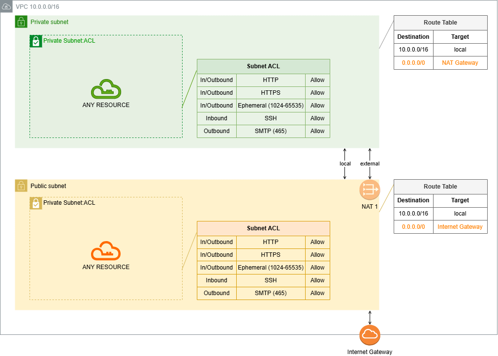

# CDK001 Typescript: Network Basic Infrastructure

Description: This CDK creates a basic network architetcture, based on a VPC with public/private subnets and respective Route Tables, Internet Gateway and NAT Gateway. For the subnets, NACLs are also provisioned with basic Inbound/Outbound rules.

<p align="center"></p>

## CDK Stack

This CDK project creates following network architecture:
* 1 VPC
* 1 Internet Gateway
* As many public Subnets as described in 'subnets' array of cdk.json configuration
* 1 Route Table for public traffic, with route to Internet Gateway and associated to public subnets
* 1 NACL for public subnets
* As many private Subnets as described in 'subnets' array of cdk.json configuration
* 1 NAT Gateways (and respective EIP) for each private subnet
* 1 Route Table for each private subnet, with route to respective NAT Gateway and associated to respective private subnet
* 1 NACL for private subnets

## Parameterization of CDK

The `cdk.json` file includes parametrization to deploy CDK:
```json
	"ENVCONFIGS": {
  		"environment_name": "cdk001",
  		"cidr_vpc": "10.0.0.0/16",
  		"subnet_pairs": [
  		  { "cidr_pub": "10.0.10.0/24", "cidr_pvt": "10.0.11.0/24", "nat_gtw": true },
  		  { "cidr_pub": "10.0.20.0/24", "cidr_pvt": "10.0.21.0/24", "nat_gtw": true }
  		]
  	}
```

For array 'subnet_pairs', each set defines a pair of public/private subnets, where:
* 'cidr_pub' is the CIDR for public subnet;
* 'cidr_pvt' is the CIDR for private subnet;
* 'nat_gtw' defines whether a NAT gateway is being created in public subnet for private subnet's traffic (NOT IN USE YET).
AZs for subnets will be choosen in order for each pair (first pair in AZ[0], second pair in AZ[1]...).

## Useful CDK commands

 * `cdk deploy`      deploy this stack to default AWS account, region US-EAST-1
 * `cdk diff`        compare deployed stack with current state
 * `cdk synth`       emits the synthesized CloudFormation template
