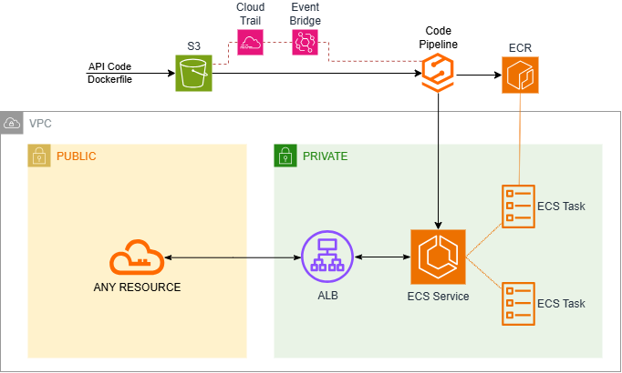
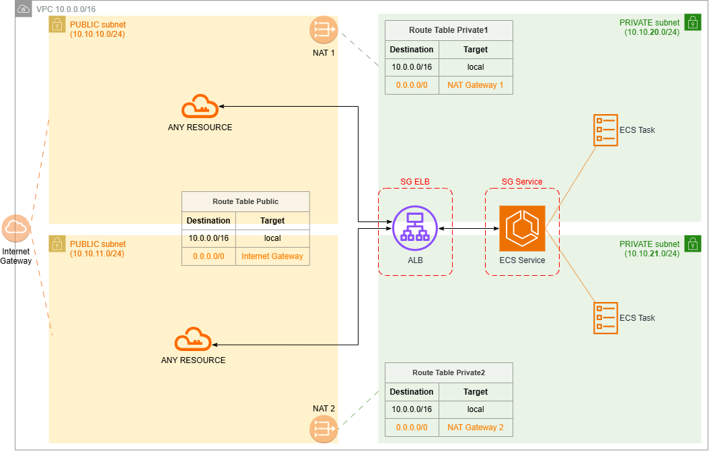
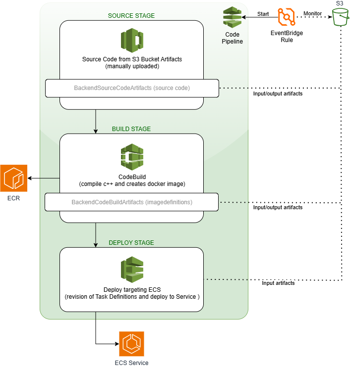
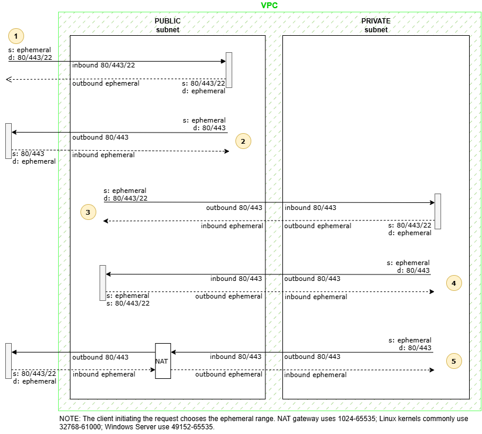

# AWS 003: Usage of ECS hosting REST API containers, with Development Tools for build and deploy

## Content

* [Demo description](#demo-description)
* [Repo files overview](#repo-files-overview)
* [Preparing the environment](#preparing-the-environment)
  * [CodePipeline: preparing file with code for source stage](#codepipeline-preparing-file-with-code-for-source-stage)
  * [Creating AWS CloudFormation stack](#creating-aws-cloudformation-stack)
* [NACL/SGs Inbound/Outbound rules definition](#naclsgs-inboundoutbound-rules-definition)
* [Notes and improvement opportunities](#notes-and-improvement-opportunities)
* [Testing](#testing)
  * [ECS Exec for troubleshooting ECS containers](#ecs-exec-for-troubleshooting-ecs-containers)

```diff
# Reminder: all diagrams included in documentation are Draw.io's editable layered PNGs.
```

## Demo description

The main purpose of this demo is to have a CloudFormation Stack deploying a CodePipeline to get code files from a S3 Bucket, build a docker image with a C++ REST API, push the image into ECR, and deploy it to ECS to spin new containers (tasks) based on the newly created image.

<p align="center"></p>

The C++ REST API is located at the folder 'rest-api' in [MariMendM/cpp-sandbox](https://github.com/MariMendM/cpp-sandbox). It is just a shell, implementing nothing more than /api (which is used for health check), and /api/resource-a (printing a simple message). Other methods and resources return success, but with a mere message of "not implemented". The API is not the main reason of this project, it is just a bare minimum to demo AWS services connected to make it work.

The intentional architecture is designed to have public subnet resources sending requests to privately hosted ELB/ECS, with no external internet requests reaching the ELB directly. To host the ELB/ECS Service privately, a base VPC is also created, with two private and two subnets, plus Internet and NAT gateways, Route Tables, NACLs and Security Groups. Within this pub/private configuration, this architetcture could be further extended adding public resources hosted in the public subnet to access the private Application Load Balancer in front of the ECS. The [testing](#testing) section suggests doing it by launching an EC2 Instance manually.

> <details><summary>Expand for networking architetcture enclosing ECS</summary></details>

:bangbang: Atention: This demo have costs, although not significant ones if running for just a couple of hours.


## Repo files overview

> NOTE: No CDK provided for this project!

* **documents/**: diagrams to support documentation;
* **buildspec.yml**:
  * CodeBuild yaml spec, defining what to run in each of the CodeBuild internal stages
    * install phase: general apt installations
    * pre build phase: install build dependencies and compiles the C++ REST API
    * build: builds the docker image using provided dockerfile
    * post build phase: logs in the ECR and pushes the built image, creating the 'imagedefinitions' file required for the CodePipelie Deploy stage
    * artifacts: exposes the 'imagedefinitions' as artifact for the CodePipeline
* **dockerfile**:
  * Used within CodeBuild to build the docker image to be stored in ECR. It copies the files /bin/restapi.app (generated by compiling the C++ REST API) and dependencies script used to install required runtime libraries, install said libraries, and gets the app running at port 8080. Curl is also installed, because it is required to run the ECS healthchecks
* **cfn-reference-template.yml**:
  * VPC
    * 1 VPC
    * 4 subnets (2 public, 2 private)
    * 3 route tables (1 for public subnets, 1 for each private subnet)
    * 1 internet gateway (route in public route table)
    * 2 NAT Gateways (routes in private route tables)
    * 2 network ACLs
      * 1 for public traffic
      * 1 for private traffic
      * Inbound/Outbound rules according to section explaining [rules definition](#naclsgs-inboundoutbound-rules-definition)
      * By default the creation of a VPC also deploys one NACL not reachable for changes by CloudFormation
  * Security Groups
    * 1 for ECS Service spinning private tasks (containers)
    * 1 for ELB of private instances
    * Inbound/Outbound rules according to section explaining [rules definition](#naclsgs-inboundoutbound-rules-definition)
    * By default the creation of a VPC also deploys one SG not reachable for changes by CloudFormation
  * ECS
    * 1 Cluster
    * 1 Service
    * 1 Task Definition
    * 1 ECR repository
  * ELB
    * 1 application ELB, internal, for ECS Service
    * 1 listener HTTP at port 8080
    * 1 target group, targeting private instances
  * Pipeline to get code from source, build app/docker image, and deloy it to ECS
    * 1 S3 Bucket for artifacts
    * 1 CodeBuild (compile c++ and build dockerfile)
    * 1 CodePipeline
      * source stage: monitoring the Bucket for artifacts for upload of zip file with source code
      * build stage: CodeBuild
      * deploy stage: creating a new ECS Task Definition revision and forcing ECS Service to spin new tasks over it
    * 1 EventBridge rule to detect upload of new files in the Artifacts Bucket and trigger the pipeline
    * 1 CloudTrail trail enabling object-level data logging events for the Artifacts Bucket, allowing EventBridge to capture them
    * 1 S3 Bucket for the trail to store its logs, with a Bucket Policy attached to it managing permissions of CloudTrail
  * IAM roles
    * 1 CodePipeline role
    * 1 CodeBuild role
    * 1 ECS Task Definition Execution role
    * 1 ECS Task Definition role
    * 1 EventBridge Target role


## Preparing the environment

### CodePipeline: preparing file with code for source stage

<ins>SOURCE STAGE</ins>: This demo uses the C++ REST API from the repo [MariMendM/cpp-sandbox](https://github.com/MariMendM/cpp-sandbox). Considering it will not focus on the connection to repositories, the source code stage from the pipeline will be simplified by using a zip file manually dropped within and S3 Bucket. The file has to be prepared by:
* locally downloading the 'buildspec.yml' and 'dockerfile' of this cdk003 folder;
* locally downloading the folder 'rest-api' from [MariMendM/cpp-sandbox](https://github.com/MariMendM/cpp-sandbox) containing the code of the C++ REST API;
* zipping it all toghether.
Final required strucuture of the file:

```
    code.zip
    |___ rest-api/
         |___ dependencies/
         |___ src/
         |___ main.cpp-sandbox
         |___ ...
    |___ buildspec.yml
    |___ dockerfile
```

The name of the file has to be the same value input in the Stack variable 'Filename of zipped code to be uploaded to S3' (default value 'code.zip'). After the creation of the stack, the file has to be manually uploaded into to the artifacts bucket created by the stack, whose name can be acquired from the outputs of the stack.
The pipeline has an EventBridge rule monitoring the artifacts bucket for the file, and this rule takes effect immediatelly upon pipeline creation; pipeline's first run will then fail due to the lack of the file. Each subsequent upload of the file in the bucket will automatically trigger the pipeline.

<ins>BUILD STAGE</ins>: Accomplished by CodeBuild, this stage compiles the C++ REST API, and creates the docker image, pushing it to the ECR repo. As artifacts, it produces the 'imagedefinitions.json' file according to AWS guidelines, containing the name of the container and the ECS URI of the image. This file is mandatory for the deploy stage.

<ins>DEPLOY STAGE</ins>: This stage uses ECS as Action Provider, reading the information of 'imagedefinitions.json' to get the ECR URI and push the built base image into the ECS Service/Cluster. The result is the creation of a new revision for the ECS Task Definition, with the update of the ECS Service to spin a new running task using the new revision (i.e., the built image running into a new container)

> <details><summary>Expand for the CodePipeline Diagram and stages!</summary></details>


### Creating AWS CloudFormation stack

Create the stack by uploading the 'cfn-reference-template.yml' into CloudFormation. Parameters:
* General Configuration
  * Environment Name: the name to be used for naming/tagging resources created by stack (default 'cdk003')
  * Environment Type: used to define a conditional when allowing CIDR/ports of NetworkACLs and Security Groups
    * MAINTENANCE allows for CIDR/ports required to maintain/troubleshoot/test resources in the VPC
    * PRODUCTION only allows for CIDR/ports extrictly required for the designed architectural usage
    * The idea is to always run the creation of the stack using MAINTENANCE, updating after to PROD (and alternate between both as necessary)
    * Default 'Maintenance'
* Source Code and Container Configuration
  * Filename of zipped code to be uploaded to S3: file name of the zipped code explained in the previous section (default 'code.zip')
  * Container name: the name to be used for the container images in ECR and running containers within ECS (default 'restapi')
* Network Configuration
  * VPC IP range: CIDR block for VPC created by stack (cannot be already in use)
  * Public/Private SubnetX VPC IP range: CIDR block for public and private subnets; must be in accordance to VPC's CIDR block; they cannot conflict with CIDR block from each other
  * Ip4ServerConnection: IP or CIDR block from machines that can SSH EC2 resources in public subnets


## NACL/SGs Inbound/Outbound rules definition

Not all architetctures require NACL rules too tight to the traffic running across subnets, being the SGs what actually give granularity in terms of security. This section was added more as an exercise for this demo on how to analyze which CIDR/ports are required or not for each choice of the input parameter 'Environment Type', as described in section [Creating AWS CloudFormation stack](#creating-aws-cloudformation-stack).

The Ports Diagram illustrate the general cases of traffic paths (numbered yellow circles) that may occur across "internet / public subnets / private subnets", and how ports are used while getting in/out from subnets:

<p align="center"></p>

From those paths, this demo:

* REQUIRES **Path 3**, intentional to this architecture: (1) having resources in VPC's public subnets sending requests to ELB/ECS resources deployed entirely in the private subnets, via port 8080; and (2) having the private ELB responding back with ephemeral ports;
  > pub-outb-8080 -> pvt-inb-8080 -> pvt-outb-ephemeral -> pub-inb-ephemeral
* REQUIRES **Path 5** 443, for private ECS Service to pull images from ECR (more details in (#notes-and-improvement-opportunities));
  > pvt-outb-443 -> pub-inb-443 -> pub-outb-443 -> pub-inb-ephemeral -> pub-outb-ephemeral -> pvt-inb-ephemeral
* Can use **Path 5** 80/443, for maintenance of private resources, like running apt-get in private ECS containers;
  > pvt-outb-80/443 -> pub-inb-80/443 -> pub-outb-80/443 -> pub-inb-ephemeral -> pub-outb-ephemeral -> pvt-inb-ephemeral
* Can use **Path 1** for testing the demo, connecting local machines to public resources via SSH; no use for 80/8080/443
  > pub-inb-22 -> pub-outb-ephemeral
* Can use **Path 2** for maintenance of public resources, like running apt-get in public EC2 instances;
  > pub-outb-80/443 -> pub-inb-ephemeral
* Doesn't require **Path 4** at all;
* ICMP was not considered once ECS doesn't support it.

To support these paths, the set of Inbound/Outbound rules for the **public NACL** (NetworkACLPub) must allow:

* Mandatory rules, created no matter the option chosen for 'EnvType'
  * **Inbound (0.0.0.0/0) for ephemeral**: (path 3/5) 
  * **Inbound (0.0.0.0/0) for 443**: (path 5)
  * **Outbound (0.0.0.0/0) for 8080**:(path 3)
  * **Outbound (0.0.0.0/0) for 443**: (path 5)
  * **Outbound (0.0.0.0/0) for ephemeral**: (path 5)
* Rules created only when 'EnvType' is 'Maintenance'
  * Inbound (0.0.0.0/0) for 80: (path 5)
  * Inbound (Ip4ServerConnection) for 22: (path 1) configured only for the IP range specified in the input parameter 'Ip4ServerConnection'
  * Outbound (0.0.0.0/0) for 80: (path 2/5)

For the **private NACL** (NetworkACLPvt), considering that the private subnet does not have a route to the internet, it is not reachable by default, and all internal VPC access can be allowed. This includes all traffic originated from resources in the public subnet, so the 'all internal traffic' rules already cover the intent of the architecture:

* Inbound (VPC CIDR) allowed for all ports: mandatory
* Outbound (VPC CIDR) allowed for all ports: mandatory

For the external traffic, the rules should cover the pull from ECR, and the maintenance for private resources, so the Inbound/Outbound rules must also include:

* **Inbound (0.0.0.0/0) for ephemeral**: (path 5) mandatory, created no matter the option chosen for 'EnvType'
* **Outbound (0.0.0.0/0) for 443**: (path 5) mandatory, created no matter the option chosen for 'EnvType'
* Outbound (0.0.0.0/0) for 80: (path 5) created only when EnvType is 'Maintenance'

For the SGs:
* The SG for the ECS Service (SecGroup4PvtECS) allows all internal traffic from the VPC
* The SG for the ELB (SecGroup4EcsELB) allows all internal traffic from the VPC in port 8080

> Important: for ephemeral ports, the client initiating the request chooses the ephemeral range. NAT Gateway/ELB/Lambdas use 1024-65535; Linux kernels commonly use 32768-61000; Windows Server uses 49152-65535. The broader range 1024-65535 is required once NAT Gateway/ELB are in use.


## Notes and improvement opportunities

* The region configured within CloudFormation template is mostly parameterized to use the region of the deployment of the Stack, but it may be hard-coded here and there as 'us-east-1' (not deeply checked).

* The artifacts bucket for the CodePipeline/CodeBuild is created within the Stack. This means that as soon as the pipeline is created, it already runs and fails, once the bucket is empty. After stack creation, the file 'code.zip' must de uploaded to the bucket.

* The C++ REST API runs in the container binded to the Host IP, which ties it to the private IP assigned to the container. That allows the API to be accessed properly, but prevents health checks from being configured, once they can only use the localhost for calls. The solution was to create an environment variable to the container (within Task Definition configuration) pointing HOSTNAME to 0.0.0.0, which allows the application to listen from all network interfaces. It seems that ECS injects/overrides HOSTNAME with something else, so it has to be reset; this allows both application and health checks to work properly.

* ECS healthchecks are configured using the /api path, which returns expected code 200:
  ```CMD-SHELL, curl -v http://localhost:8080/api || exit 1```

* For the VPC, the CloudFormation template was configured to avoid cross-AZ NAT traffic and extra costs, so:
  * SubnetPub1 and SubnetPvt1 are both settled in the same AZ, and SubnetPvt1 directs traffic only to the NatGateway1 associated to the SubnetPub1;
  * the same for netwrok resources numbered 2 (SubnetPub2...).

* ECS Service is configured in private subnets, with a Load Balancer in front of it. Security Groups and NACL from public/private subnets allowing traffic to flow from/to them have only the required CIDR/Ports when the stack input parameter 'EnvType' is defined as 'Production', option that represents what would be the intent of the architetcture, which is public resources within the VPC sending requests to the private ELB/ECS. When 'EnvType' is defined as 'Maintenance', the CIDR/Ports allowed is broader, but also analyzed only for the puproses of maintenance.

* The ECS Service sitting in private subnets is currently pulling ECR images via NAT Gateway (private subnet -> public subnet -> NAT -> internet (ECR's enpoint) -> and back!), which means that it is not keeping the traffic internal to the AWS private network. A VPC Endpoint for ECR could be added to solve this problem, also reducing NAT Gateway data processing charges for pulls.

* When configured with a 'desired count' different from zero in the CloudFormation template, the ECS Service gets stucked in "in progress" state in the Stack while the desired count is not reached. Given that a file must de uploaded to the bucket artifacts, the Pipeline must run, and an container image must be pushed to ECR before a task can successfully run in the Service, the template is configured with 'desired count' equals to zero for Stack properly creation. Then, it can be manually adjusted in the console for the service when everything is up and running.


## Testing

* Create the stack;
* After stack gets completed, upload the 'code.zip' file (prepared according to the instructions laid before in this document) into the bucket created for the artifacts of the pipeline (name in the outputs of the stack)
  * the pipeline will start running;
* Update the ECS Service (Quick Update) and set desired count to 2
  * as soon as the pipeline finishes, the service will spin two new running tasks, one in each private subnet
  * the tasks will run over the new Task Definition Revision created by the Deploy Stage of the pipeline
  * the tasks will very soon enter 'running' state with a 'healthy' status;
* Reach for the Application Load Balancer, and copy its DNS name
  * access the API through curl (more test options in the [API documentation](https://github.com/MariMendM/cpp-sandbox/tree/main/rest-api))
   ```
   curl -v http://<ELB-DNS-NAME>:8080/api
   ```
  * the individual tasks can be also reached through curl
   ```
   curl -v http://<TASK-PRIVATE-IP>:8080/api
   ```
  * <ins>important</ins>: the ELB and private tasks can be accessed either from inside private subnets or from connected public subnet; an EC2 instance can be launched in either of the scopes, altough an instance is more easily accessible from the public subnet via SSH or 'console connect' (this same functionality for private instances will require further configuration).

### ECS Exec for troubleshooting ECS containers

In order to run ECS Exec (docker exec -it container bash) in a running container:
* the Task Definition must have proper IAM permissions (configured in template's resource 'RoleIAM4EcsTaskRole');
* the service must enable it ('EnableExecuteCommand: true' in template's resource 'ECSService'); to manually enable it:
   ```
   aws ecs update-service \
  --cluster CLUSTER_NAME \
  --service SERVICE_NAME \
  --task-definition TASK_NAME:REVISION \
  --enable-execute-command
  ```
  > NOTE: roles must be properly configured or it will not enable!

* the following commands should be run in a CloudShell session (check option to "bin/bash" depending of the distro):
   ```
   aws ecs execute-command \
   --cluster CLUSTER_NAME \
   --task TASK_ID \
   --container CONTAINER_NAME \
   --interactive \
   --command "/bin/bash"
   ```

Some commands that may help with troubleshooting configurations:

   ```
   aws ecs describe-tasks --cluster CLUSTER_NAME --tasks TASK_ID
   ```
