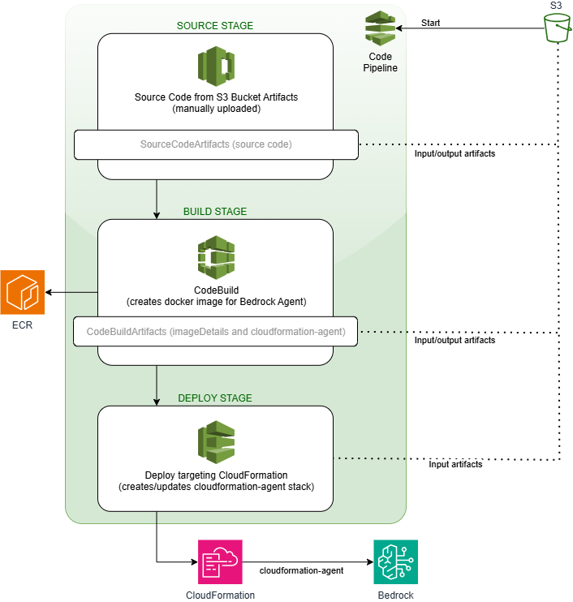

[](https://shields.io/)

# AWS 004: Strands Agent in Bedrock AgentCore Runtime, with CodePipeline for build and deploy

## Content

* [Demo description](#demo-description)
* [Repo files overview](#repo-files-overview)
* [Preparing the environment](#preparing-the-environment)
  * [CodePipeline: preparing file with code for source stage](#codepipeline-preparing-file-with-code-for-source-stage)
  * [Creating AWS CloudFormation stack](#creating-aws-cloudformation-stack)
* [Notes and improvement opportunities](#notes-and-improvement-opportunities)
* [Testing](#testing)
* [Cleaning up](#cleaning-up)

```diff
# Reminder: all diagrams included in documentation are Draw.io's editable layered PNGs.
```

## Demo description

The main purpose of this demo is to have a Strands Agent built and deployed to AWS Bedrock AgentCore Runtime by IaC. A CloudFormation stack provisions a CodePipeline to: get source code files from an S3 Bucket; build the docker image over the python-strands code, pushing it into an KMS-encrypted ECR; and deploy/update the stack provisioning the Bedrock Agent Runtime to host the agent.

<p align="center"></p>

The Strands Agent acts as a "Queen music historian assistant", built over the 'Amazon Nova 2 Lite' as foundational model, and powered by datasets and custom tools generated with Gemini over requirements of what the agent should be able to answer. Code is provided in Python.

> <details><summary>Expand for Agent diagram!</summary></details>

:bangbang: Attention: This demo have costs, although not significant ones if running for just a couple of hours.


## Repo files overview

> NOTE: No CDK provided for this project!

* **documents/**: diagrams to support documentation;
* **cloudformation-pipeline.yml**:
  * ECR
    * 1 Repository
    * 1 KMS Key
  * Pipeline to get code from source, build docker image for Agent, and deploy it to Bedrock AgentCore Runtime
    * 1 S3 Bucket for artifacts
    * 1 CodeBuild
    * 1 CodePipeline
      * source stage: monitors the Bucket Artifacts for the upload of a zip file with source code
      * build stage: CodeBuild (build of agent's dockerfile)
      * deploy stage: creates/updates the Bedrock AgentCore Runtime stack, via CloudFormation, using the image from ECR
  * IAM roles
    * 1 CodePipeline role
    * 1 CodeBuild role
    * 1 Deployment role, for the CloudFormation step of CodePipeline
  * CloudFormation
    * Metadata Interface, Parameters (user input), Resources, Outputs
* **cloudformation-agent.yml**:
  * Bedrock
    * 1 AgentCore Runtime
    * 1 AgentCore Memory
  * IAM roles
    * 1 AgentCore Runtime role
    * 1 AgentCore Memory role
  * CloudFormation
    * Parameters (parameter overrides), Resources, Outputs
* **buildspec.yml**:
  * CodeBuild yaml spec, defining what to run in each of the CodeBuild internal stages
    * pre build: logs in the ECR
    * build: builds the agent's docker image using provided dockerfile
    * post build: tags and pushes the built image, creating the 'imageDetail' file required for the CodePipeline Deploy stage
    * artifacts: exposes the 'imageDetail' and 'cloudformation-agent' (passed forward from the source) as artifacts for CodePipeline's next stage
* **agentcore/runtime/**:
  * **dockerfile**: builds the agent's docker image to be stored in ECR
  * **queen_catalog.csv**: CSV file generated with Gemini, containing Queen's catalogue with information like albums, songs, writers, singers, years and genres, to serve as source information for the agent's Strands tools
  * **requirements.txt**: python dependencies
  * **strands_agent_queen_catalog.py**: Strands agent main file
  * **strands_tools_queen_catalog.py**: class QueenCatalogTools, created with Gemini, providing tools to handle the catalogue of Queen's songs.
  * **sagemakerai-agent-playground.ipynb**: Jupiter Notebook exported from SageMaker AI, where code was developed/tested before be encapsulated in an BedrockAgentCoreApp for the AgentCore Runtime


## Preparing the environment

### CodePipeline: preparing file with code for source stage

<ins>SOURCE STAGE</ins>: The source code stage from the pipeline will be simplified by using a zip file manually dropped within an S3 Bucket instead of source code repos. This stage has 'PollForSourceChanges' set to true, so each upload of the file in the bucket will automatically trigger the pipeline.
The file has to be prepared by downloading the content of this GIT repository and zipping it. The name of the file has to be the same value input in the Stack variable 'Filename of zipped code to be uploaded to S3' (default value 'code.zip'). The file has to be manually uploaded into to the artifacts bucket, whose name can be acquired from the outputs in the CloudFormation console, after cloudformation-pipeline.yml execution.

<ins>BUILD STAGE</ins>: Accomplished by CodeBuild, this stage creates the docker image for the Strands agent to be hosted in Bedrock AgentCore Runtime, pushing it to the ECR repository. As artifacts, it produces the 'imageDetail.json' file, storing the URI of the pushed container image (ECR URI + tag), also passing forward the file 'cloudformation-agent.yml' from the source. Both files are required by the deploy stage.

<ins>DEPLOY STAGE</ins>: This stage uses CloudFormation as Deploy Provider, getting the container image URI from the 'imageDetail.json' and injecting it along with other parameters as Parameter Overrides for the stack cloudformation-agent.yml, provisioning the Bedrock resources to host the agent.

> <details><summary>Expand for the CodePipeline Diagram and stages!</summary></details>

### Creating AWS CloudFormation stack

Create the stack by uploading the 'cloudformation-pipeline.yml' into CloudFormation. Parameters:
* Environment Name: the name to be used for naming resources created by stack (default 'cdk004')
* Filename of zipped code to be uploaded to S3: file name of the zipped code explained in the previous section (default 'code.zip')
* Container name: the name to be used for the container images in ECR (default 'queen_catalog_agent')
* Agent name: the name to be used for the Bedrock Agent (default 'queen_catalog_agent')

## Notes and improvement opportunities

* There is no region hard-coded within CloudFormation Pipeline and Agent templates, fully parameterized to use the region of the deployment of the Stacks. The Pipeline stack deployment region then will define the region of the whole deployment.

* The artifacts bucket for the CodePipeline/CodeBuild is created within the Stack. This means that as soon as the pipeline is created, it already runs and fails, once the bucket is empty. After stack creation, the file 'code.zip' must be uploaded to the bucket.

* The SourceCode Stage of the pipeline has 'PollForSourceChanges' set to true, which indicates that the artifacts bucket will be polled for uploads. This is the legacy polling mechanism, being an (not recommended!) alternative approach to what was implemented in cdk003 (EventBridge rule over CloudTrail logs). This polling works by having CodePipeline periodically check if the defined S3 Object Key has been modified (by comparing the object's ETag or last modified timestamp). Being so, it is a bit slower to react to an uploaded file, and it is expected to have a delay when compared to cdk003 strategy.

* The Agent has some scope definitions in its prompt, with instructions to only respond data over the Queen's discography provided by the CSV, but no extensive testing was performed about scope creep and misbehaviour. The agent could be improved by adding Strands and/or Bedrock guardrails, but this was not included in the scope of this demo.


## Testing

* Create a CloudFormation stack for the cloudformation-pipeline.yml
* After stack gets completed, upload the 'code.zip' file (prepared according to the instructions laid before in this document) into the bucket created for the pipeline's artifacts (name of bucket in the outputs of the stack)
  * the pipeline will start running
* When CodePipeline finishes with success:
  * to test the agent:
    * go to the Bedrock AgentCore Console, Agents menu, and click over the provisioned agent
    * click 'Test Agent'
    * chose any prompt about Queen discography (suggestions below) and click 'Run'
    * wait for the answer
  * to test memory:
    * type prompts related to questions/answers already provided by the agent (a very obvious prompt would be "what are my questions so far?")
  * to check observability:
    * TODO!
  NOTE: Logs and observability are turned on for the Agent. (TODO here...) 

Prompt suggestions:
 * "List all songs written by John Deacon"
 * "Find all Hard Rock tracks from 1974 where Freddie Mercury is the singer"
 * "What are the most predominant Queen genres?"
 * "Show me all ballads released between 1974 and 1977"
 * "Who wrote the most songs in the catalogue in the 80's?"
 * "Find all songs sung by Brian May"
 * "List all singers that are not members of the band"


## Cleaning up

* Delete stack created over cloudformation-agent.yml, and then the stack created over cloudformation-pipeline.yml (in this order, otherwise, the role that handles CloudFormation creation/updates will be wiped out and the agent stack will not be removed!);
* Delete all the ECR images, and then the ECR itself;
* Delete all the S3 artifacts bucket objects, and then the Bucket itself.

Note: ECR and Bucket are protected by deletion policy 'RetainExceptOnCreate'. If the stack fails during creation, they will get deleted, but both will need manual deletion once used.